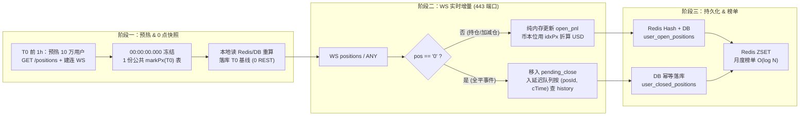
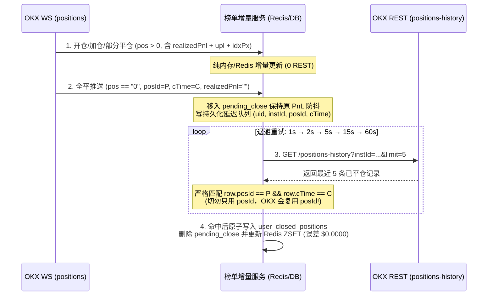

# OKX OpenAPI 月度榜单 PnL 计算方案 — 技术可行性验证报告

> **验证日期：** 2026-11-24 | **验证环境：** OKX v5 Demo Trading（真实下单 + 私有 WebSocket） | **覆盖品类：** USDT 永续 / 币本位永续 / 币本位交割 / USDC 结算合约 | **对账误差：** `$0.0000`

---

## 一、执行摘要

1. **两种轻量化方案均已实盘验证可行（10 万用户量级均为 `O(1)` 实时更新，内存 <150MB）：**
   - **纯合约榜单（推荐）：** `positions` + `positions-history` + WS `positions` 增量监听（天然免疫划转与现货币价波动，实测 4 大合约品类 WS vs REST 对账误差 **`$0.0000`**）。
   - **全账户榜单（现货 + 合约）：** `totalEq(Now) - NetTransfers - totalEq(T0)` + WS `account`（仅查 `bills-archive?type=1` 划转并按天聚合，缺失 `Cash@T0` 用 `end=T0&limit=1` 单次读取 `bal` 字段）。
2. **10 万用户 1 号 0 点「零横截面偏移」快照：** 0 点前平滑预热持仓与 WS 连接；`00:00:00.000` 冻结 **1 份全市场共享 `markPx(T0)` / `idxPx(T0)` 表**，本地读 Redis/DB 统一重算（**0 次私有 REST 并发冲击，0ms 价格偏移**）。
3. **关键 OKX 实测深坑已全部跑通解决：** `pos=="0"` 全平帧清空 `realizedPnl`、`positions-history` 1–2s 索引延迟（必须用 `(posId, cTime)` 严格匹配，不能只用 `posId`）、币本位 `idxPx` 实时折算 USD、WS `443` 端口迁移。

---

## 二、两种轻量化方案对比（10 万用户量级）

| 对比维度 | 方案 A：仓位增量法（`positions + WS`） | 方案 B：优化总权益法（`totalEq + 日聚合 type=1 划转`） |
| --- | --- | --- |
| **榜单口径** | **纯合约交易 PnL**（免疫现货涨跌与充提划转） | **交易账户总权益 PnL**（现货 + 合约一并计入） |
| **每事件计算复杂度** | `O(1)` 差值增量更新（<150 MB 内存） | `O(1)`（`totalEq - 30天日聚合划转 - t0_eq`） |
| **WS 状态机复杂度** | 需 `pending_close` + `(posId, cTime)` 延迟队列 | 更简单（WS `account` 直接推 `totalEq`，无全平队列） |
| **缺失 T0 快照补数** | 无跨月老仓仅 2 次 REST（~200ms）；有跨月按 `instId` 局部补数 | `bills-archive?ccy=c&end=T0&limit=1` 1 次拿 `Cash@T0` + `type=1` 划转 + 跨月 `UPL@T0` |

---

## 三、完整计算公式（精确到 OKX 字段）

### 3.1 方案 A：仓位增量法（纯合约榜单）

**1. 结算币种 USD 汇率 `P_usd(ccy, t)`：**
- 稳定币（`USD` / `USDT` / `USDC`）：`P_usd = 1.0`
- 币本位（`BTC` / `ETH` 等）：
  - 持仓实时更新：`P_usd = ws.idxPx`（兜底 `ws.markPx`，无需额外 REST）
  - 平仓落袋入账：`P_usd = IndexCandle(ccy-USD, uTime)`

**2. 有符号张数 `Q(p)` 与 `T0` 时刻未实现盈亏 `UPL_usd(p, T0)`：**
- `posSide == "net"` → `Q = pos`；`posSide == "long"` → `Q = +|pos|`；`posSide == "short"` → `Q = -|pos|`
- **正向合约**（`ctType == "linear"`，如 `BTC-USDT-SWAP`、`BTC-USD_UM-261225`）：

```text
UPL_usd(p, T0) = Q(p) × ctVal × (markPx(T0) - avgPx) × P_usd(ccy, T0)
```

- **反向/币本位合约**（`ctType == "inverse"`，如 `BTC-USD-SWAP`、`BTC-USD-261225`）：

```text
UPL_usd(p, T0) = Q(p) × ctVal × (1 / avgPx - 1 / markPx(T0)) × P_usd(ccy, T0)
```

**3. 月初 0 点基线快照（仅对 `T0` 时刻未平仓位 `cTime < T0`）：**

```text
SnapshotPnL(p, T0) = realizedPnl(p, T0) × P_usd(ccy, T0) + UPL_usd(p, T0)
```

> **重要：** OKX 的 `realizedPnl` 已自动包含 `pnl + fee + fundingFee + liqPenalty + settledPnl`，切勿重复加减手续费或资金费。

**4. 单仓位本月贡献与用户月度总 PnL：**

```text
MonthPnL_closed(p) = realizedPnl_final × P_usd(ccy, uTime) - (cTime < T0 ? SnapshotPnL(p, T0) : 0)
MonthPnL_open(p)   = (realizedPnl_now + upl_now) × P_usd(ccy, Now) - (cTime < T0 ? SnapshotPnL(p, T0) : 0)

MonthlyPnL_user = Σ MonthPnL_closed(p) + Σ MonthPnL_open(p)
```

*(若只需用户级总榜单，可将 `Σ SnapshotPnL(p, T0)` 合并存为 1 条用户级标量 `user_t0_pos_pnl`，数学完全等价。)*

---

### 3.2 方案 B：账户总权益法（全账户：现货 + 合约）

```text
MonthlyPnL_equity = totalEq(Now) - NetTransfers(T0, Now] - totalEq(T0)
```

- **净划转（按天聚合，仅查 `bills-archive?type=1`）：**

```text
DailyNetTransfer(day) = Σ [ bill.balChg × P_usd(bill.ccy, bill.ts) ]   (balChg > 0 转入，< 0 转出)
NetTransfers(T0, Now] = Σ DailyNetTransfer(day)                        (最多 30 条日聚合记录相加)
```

- **缺失 `totalEq(T0)` 快照时的还原：**

```text
totalEq(T0) = Σ [ CashBal_c(T0) × P_usd(c, T0) ] + Σ UPL_usd(p, T0)
```

其中 `CashBal_c(T0)` 直接读取 `GET /api/v5/account/bills-archive?ccy=c&end=T0&limit=1` 的 `bal` 字段（1 次请求，免分页）。

---

### 3.3 账单（`bills-archive`）还原月初快照的原理、字段与查询范围

- **原理：** OKX 交易账户账单类似**银行流水账**，每笔资金变动都会记录变动额 `balChg` 与变动后账户余额 `bal`（仅覆盖现金余额，未平仓浮盈 `UPL(T0)` 需另由跨月持仓 + `markPx(T0)` 计算）：
  - **方式 1（推荐，1 次请求）：** 查 `end=T0&limit=1`（`ts <= T0` 最新一条），其 `bal` 字段即为精确 `CashBal(T0)`。
  - **方式 2（兜底）：** 若 `T0` 前 3 个月无账单，则 `CashBal(T0) = CashBal(Now) - Σ balChg(T0, Now]`。
- **核心字段（仅 5 个）：** `ccy`（币种）、`ts`（时间戳）、`bal`（变动后余额）、`balChg`（变动额）、`type`（类型：`1`=划转、`2`=交易、`8`=资金费）。
- **有 N 个 `instId` 需要遍历 N 次吗？不需要！**

| 查询目标 | 查询维度（无需遍历 N 个 `instId`） | 时间范围 | 接口开销 |
| --- | --- | --- | --- |
| **`CashBal(T0)`（方式 1）** | 按 **`ccy`**（通常仅 1～4 个币种，如 USDT/BTC） | `end = T0, limit = 1`（近 3 个月内） | **每币种 1 次请求** |
| **`CashBal(T0)`（方式 2 兜底）** | 全账户一次查（不传 `instId`） | `begin = T0, end = Now`（1～30 天） | 100 条/页分页 |
| **净划转 `NetTransfers`** | 全账户 + `type = 1`（不传 `instId`） | `begin = T0, end = Now`（1～30 天） | 通常 **1 页** |
| **跨月仓位 `fills-history`** | **仅**查 `cTime < T0` 的跨月合约（通常 0～3 个） | `begin = T0, end = Now`（1～30 天） | 仅跨月合约少量分页 |

#### 跨月仓位 `UPL(T0)` 零误差还原数值案例

```text
【真实交易过程（11 月 1 日 00:00 未拍快照）】
  • 10 月 25 日：初始现金 $10,000，开多 1 BTC (100张, ctVal=0.01) @ $60,000，开仓费 -$30 → 现金 $9,970
  • 11 月 1 日 00:00 (T0)：BTC 标记价 = $65,000 → 真实 totalEq(T0) = $9,970 + $5,000 = $14,970
  • 11 月 10 日：在 $68,000 全平，平仓费 -$34 → 现金 $17,936 → 真实 11 月 PnL = $17,936 - $14,970 = +$2,966

【无快照还原步骤（误差 = $0.00）】
  1. Cash(T0)：bills-archive?ccy=USDT&end=T0&limit=1 → 直接得 bal = $9,970（10 月 -$30 开仓费已自动扣完）
  2. Q(T0) & avgPx(T0)：positions-history + fills-history(T0→Now) → 1 BTC @ $60,000
  3. markPx(T0)：history-mark-price-candles (00:00:00 1m 开盘价) → $65,000
  4. UPL(T0) = 100 × 0.01 × ($65,000 - $60,000) = +$5,000 → 还原 totalEq(T0) = $14,970
  5. 还原 11 月 PnL = $17,936 - $14,970 = +$2,966（误差 $0.00）

【唯一有误差的 2 种情况】
  1. 跨月仓位在 T0 之后既有加仓又有部分平仓，但跳过 fills-history；
  2. 跨月仓位开仓早于 3 个月前（超出 fills-history 保留期）且 T0 后反复加减仓。
```

---

## 四、系统架构与全平事件流程图

### 4.1 端到端架构流程（方案 A：冷启动 + WS 增量 + 0 点零偏移快照）



### 4.2 全平事件闭环时序（解决 `pos=="0"` 清空盈亏 + 1–2s 索引延迟）



---

## 五、全品类模拟盘实测结果

在 OKX Demo 账户上完成 4 大合约品类实盘下单 + WS 增量对账：

| 合约品类 | 实测合约 ID | 结算币种 (`ccy`) | 实测动作 | WS 增量结果 | REST 权威对账 | 误差 |
| --- | --- | --- | --- | ---: | ---: | ---: |
| **USDT 本位永续** | `ETH-USDT-SWAP`, `SOL-USDT-SWAP` | `USDT` | 跨期全平 + 开/半平/全平 + 划转 | `+$0.2833` | `+$0.2833` | **`$0.0000`** |
| **币本位永续** | `BTC-USD-SWAP` | `BTC` (`idxPx` 折算) | 开(+1) → 平(-1) (`-0.00000159 BTC`) | `-$0.0958` | `-$0.0958` | **`$0.0000`** |
| **币本位交割** | `BTC-USD-261225` | `BTC` (`idxPx` 折算) | 开(+1) → 平(-1) (`-0.00000169 BTC`) | `-$0.1018` | `-$0.1018` | **`$0.0000`** |
| **USDC 结算交割** | `BTC-USD_UM-261225` | `USDC` | 开(+1) → 平(-1) (`-0.07330419 USDC`) | `-$0.0733` | `-$0.0733` | **`$0.0000`** |

---

## 六、线上必避的 5 个 OKX 实测深坑

1. **WS `pos == "0"` 全平帧会清空 `realizedPnl` 为 `""`** → 必须由全平事件触发延迟队列查 `positions-history`。
2. **`posId` 会在同一合约/方向上重复复用** → 延迟队列必须严格匹配 **`(posId, cTime)`**，不可仅靠 `posId` 判重。
3. **WS `fills` 频道有 VIP 等级门槛（`code: 64003`）** → 散户榜单不可依赖 `fills` WS 频道。
4. **`GET /api/v5/account/bills` 仅保留近 7 天** → 回溯 1 个月账单/划转必须使用 `GET /api/v5/account/bills-archive`（保留近 3 个月）。
5. **WS `8443` 端口即将下线并推送 `notice` 帧（`code: 64010`）** → 生产环境直接使用 **`443` 端口**（`wss://ws.okx.com/ws/v5/private`）并在鉴权时忽略 `notice` 事件。
