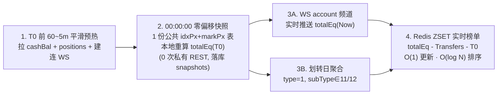
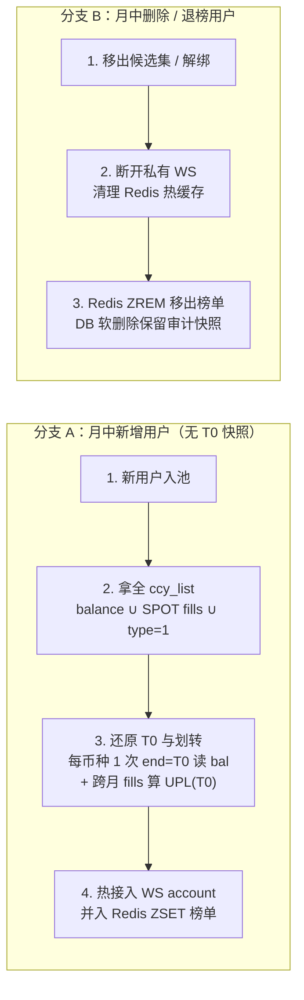

# OKX OpenAPI 月度榜单（现货 + 合约）PnL 计算方案 — 技术可行性验证报告

> **报告日期：** 2026-11-25 | **主方案：** 优化版 `totalEq` 权益法 + 按日聚合 `type=1` 划转 + WS `account` | **覆盖范围：** 现货 · 杠杆 · USDT/USDC/币本位永续 · 交割 · 期权 | **交互网页版：** https://sydowma.github.io/okx-pnl-verifier/report.html

---

## 一、执行摘要

1. **为什么确定 `totalEq` 为唯一主方案：** 实盘测试确认，买入并卖出 `SOL-USDT` 现货（`tdMode="cash"`）期间，`GET /positions`、`GET /positions-history` 与 WS `positions` 均为 **0 条记录 / 0 条推送**。只要榜单需要**包含现货**，必须采用 `totalEq(Now) - NetTransfers - totalEq(T0)` + WS `account`。
2. **账单压力已彻底消除：**
   - 日常划转仅查 `bills-archive?type=1`（过滤 `subType ∈ {"11", "12"}`）并按天聚合为 `daily_net_transfers`（通常不足 1 页/月）。
   - 月中新用户无快照还原时，通过 `balance ∪ SPOT fills ∪ type=1 bills` 拿全 `ccy list`（通常 2～8 个币种），每币种调 **1 次** `end=T0&limit=1` 直接读 `bal`，**无需全量分页账单**。
3. **实测精度与 10 万级性能：** 现货跨期持仓 + 全卖清仓 + 划转实测 `SOL/USDT` 数量还原误差 **`0.000000`**、`totalEq(T0)` 精度 **`99.9957%`**（误差 `0.0043%`）；WS `account` 直接推实时 `totalEq`，**无需 `pos=="0"` 延迟队列**，单事件计算 **`O(1)`**。

---

## 二、核心计算公式（精确到 OKX 字段）

```text
【1. 核心月度 PnL 公式（统一覆盖现货 + 杠杆 + 全部合约 + 期权）】
MonthlyPnL(T0 → Now) = totalEq(Now) - NetTransfers(T0, Now] - totalEq(T0)
# totalEq(Now) 由私有 WS `account` 频道实时推送

【2. 净划转（查 bills-archive?type=1，过滤 subType ∈ {"11"(转入), "12"(转出)}，按天聚合）】
DailyNetTransfer(day) = Σ [ bill.balChg × IndexPx(bill.ccy-USD, bill.ts) ]
NetTransfers(T0, Now] = Σ DailyNetTransfer(day)          # 全月最多 30 条日聚合记录相加

【3. 缺失 totalEq(T0) 快照时的还原（仅月中新用户冷启动执行 1 次）】
# 3.1 精准拿全 ccy list（无需遍历 300+ 币种，跳过高频合约账单）
CCY(T0) = { GET /account/balance 当前非零币种 }
        ∪ { fills-history?instType=SPOT&begin=T0&end=Now 现货交易涉及币种（抓出已卖空归零币种） }
        ∪ { bills-archive?type=1&begin=T0&end=Now 划转涉及币种（抓出已转空归零币种） }

# 3.2 每币种 1 次请求拿 CashBal_c(T0)：
# GET /api/v5/account/bills-archive?ccy=c&end=T0&limit=1 → 直接读 bal 字段（免分页）

# 3.3 跨月合约（cTime < T0）的 UPL_usd(p, T0)（必须经 fills-history 还原 Q(T0) 与 avgPx(T0)）：
# 查 GET /api/v5/trade/fills-history?instType=...&instId=<跨月合约>&begin=T0&end=Now
Q(T0) = Q(Now) - Σ fill_signed_sz(T0, Now]               # buy=+fillSz, sell=-fillSz；全平则 Q(Now)=0
# 正向 (linear)：  UPL_usd(p, T0) = Q(T0) × ctVal × (markPx(T0) - avgPx(T0)) × IndexPx(ccy-USD, T0)
# 反向 (inverse)： UPL_usd(p, T0) = Q(T0) × ctVal × (1/avgPx(T0) - 1/markPx(T0)) × IndexPx(ccy-USD, T0)

# 3.4 合并得到 totalEq(T0)（稳定币同步用 USDT-USD / USDC-USD 指数 K 线消除折溢价）：
totalEq(T0) = Σ [ CashBal_c(T0) × IndexPx(c-USD, T0) ] + Σ UPL_usd(p, T0)
```

---

## 三、系统架构流程图（拆分为 2 个独立流程）

### 3.1 流程一：月初已定义好的存量用户（10 万候选集）



### 3.2 流程二：月中动态新增 / 删除的用户（1 号～30 号热插拔）



---

## 四、跨月合约 `UPL(T0)` 零误差还原案例

```text
【真实交易过程（11 月 1 日 00:00 未拍快照）】
  • 10 月 25 日：初始现金 $10,000，开多 1 BTC (100张, ctVal=0.01) @ $60,000，开仓费 -$30 → 现金 $9,970
  • 11 月 1 日 00:00 (T0)：BTC 标记价 = $65,000 → 真实 totalEq(T0) = $9,970 + $5,000 = $14,970
  • 11 月 10 日：在 $68,000 全平，平仓费 -$34 → 现金 $17,936 → 真实 11 月 PnL = $17,936 - $14,970 = +$2,966

【无快照还原步骤（误差 = $0.00）】
  1. Cash(T0)：bills-archive?ccy=USDT&end=T0&limit=1 → 直接得 bal = $9,970（10 月 -$30 开仓费已自动扣完）
  2. Q(T0) & avgPx(T0)：必经 fills-history(T0→Now) 还原 → 1 BTC @ $60,000
  3. markPx(T0)：history-mark-price-candles (00:00:00 1m 开盘价) → $65,000
  4. UPL(T0) = 100 × 0.01 × ($65,000 - $60,000) = +$5,000 → 还原 totalEq(T0) = $14,970
  5. 还原 11 月 PnL = $17,936 - $14,970 = +$2,966（误差 $0.00）
```

---

## 五、10 万用户持久化表结构

| 表名 / 介质 | 唯一主键 | 核心字段与职责 |
| --- | --- | --- |
| `monthly_equity_snapshots` (DB) | `(month, uid)` | `total_eq_t0_usd`, `cash_usd_t0`, `upl_usd_t0`, `source`（10 万用户仅 10 万行/月） |
| `daily_net_transfers` (DB) | `(uid, date)` | `transfer_in_usd`, `transfer_out_usd`, `net_transfer_usd`（按天聚合 `type=1, subType∈{11,12}`） |
| `monthly_leaderboard` (Redis ZSET) | `leaderboard:{YYYY-MM} → uid` | `score = totalEq(Now) - SUM(daily_net_transfers) - total_eq_t0_usd` |

---

## 六、OKX 模拟盘实测证据

| 实测场景 | 涉及品种 | 真实值 (GT) | 无快照还原值 | 误差 |
| --- | --- | ---: | ---: | ---: |
| **现货跨期 + 清仓 + 划转** | `SOL-USDT` 现货 + 全账户 6 币种 | SOL `0.199840` / Eq `$72,749.72` | SOL `0.199840` / Eq `$72,746.62` | **数量 `0.000000` / 权益 `0.0043%`** |
| **跨期合约全平 + 加仓 + 划转** | `BTC-USDT-SWAP`, `ETH-USDT-SWAP` | 均价 `59915.31` / Cash `2443.5864` | 均价 `59915.31` / Cash `2443.5864` | **均价 `0` / 现金 `$0.0000` / 权益 `0.018%`** |
| **现货能否进 `positions` 接口** | `SOL-USDT` (`tdMode=cash`) | `/positions`: 0 · `/positions-history`: 0 · WS `positions`: 0 | — | **证实不可用** |

---

## 七、线上必避的 5 个 OKX 深坑

1. **`GET /api/v5/account/bills` 仅保留 7 天** → 查 1 个月必须用 `bills-archive`（保留 3 个月）。
2. **划转过滤需同时校验 `type=1` 与 `subType ∈ {"11", "12"}`** → 避免交易账户内部保证金划拨误算。
3. **稳定币估值用 `USDT-USD` / `USDC-USD` 指数 K 线** → 消除硬编码 `1.00` 带来的折溢价偏差。
4. **WS 直接用 `443` 端口**（`wss://ws.okx.com/ws/v5/private`）并在鉴权时跳过 `code: 64010` 的 `notice` 帧。
5. **WS `fills` 频道有 VIP 门槛（`64003`）** → 散户榜单不可依赖。

---

<details>
<summary><strong>附录（已归档，非当前主方案）：纯合约仓位增量法（positions + WS，不含现货）</strong></summary>

> 因需求已明确包含现货，而 OKX `positions` / `positions-history` / WS `positions` 对现货返回 0 条记录，本方案已归档，仅适用于未来单独做「纯合约榜单」的场景。

- **实测结果：** USDT 永续、币本位永续（`BTC-USD-SWAP`）、币本位交割（`BTC-USD-261225`）、USDC 结算交割（`BTC-USD_UM-261225`）WS 增量 vs REST 对账误差均为 `$0.0000`。
- **关键坑点：** ① WS `pos=="0"` 全平帧清空 `realizedPnl=""`，需 `pending_close` + 延迟队列查 `positions-history`；② `posId` 会跨交易复用，必须严格匹配 `(posId, cTime)`；③ 币本位需按 WS `idxPx` 实时折算 USD。

</details>
